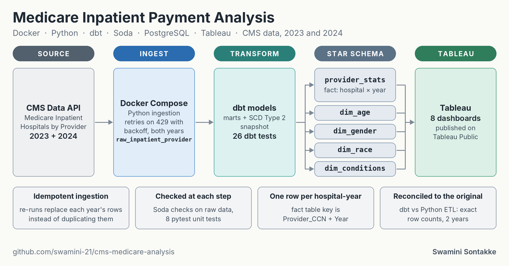
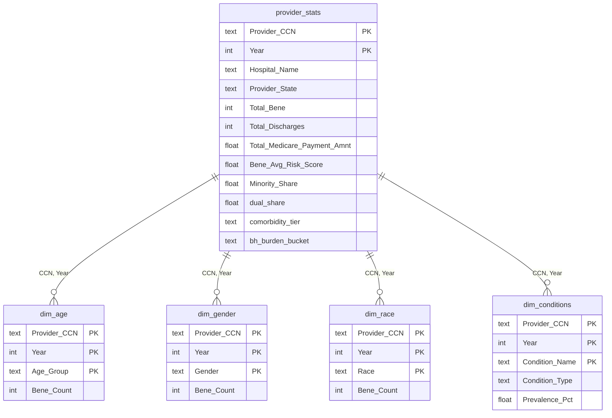

# Medicare Inpatient Payment Analysis

An end-to-end analytics project that uses CMS data to examine how Medicare inpatient payments vary across hospitals, states, and patient populations.

**Data:** CMS Medicare Inpatient Hospitals by Provider, 2023 and 2024
**Stack:** Python (ETL), PostgreSQL (star schema), Tableau (8 dashboards)

## Business Questions

| # | Question |
|---|----------|
| Q1 | How does payment per discharge vary across regions? |
| Q2 | Do minority-serving hospitals receive lower Medicare payments? |
| Q3 | Which chronic condition burden levels drive the highest Medicare expenditure? |
| Q4 | What is the charge-to-payment markup ratio across US hospitals? |
| Q5 | How do behavioral health comorbidities affect inpatient utilization? |
| Q6 | How do beneficiary age and gender composition affect payment and length of stay? |
| Q7 | Does HCC risk score predict hospital-level Medicare payments? |
| Q8 | Are high dual-eligible hospitals underpaid relative to risk-adjusted expectations? |


## Key Findings

- **Minority-serving hospitals are not paid less.** Hospitals with ≥50% minority share average $24,205 per beneficiary vs. $16,129 for low-minority hospitals. The gap persists within metro hospitals ($25,220 vs. $16,926) and shrinks by about half after controlling for state, urban/rural status, risk score, and dual-eligible share (regression estimate: +$3,927, 95% CI $2,326 to $5,527). Urban concentration therefore explains only part of the gap.
- **High dual-eligible hospitals are paid slightly more per discharge** ($13,555 vs. $12,436; median gap about $630). The gap is concentrated in metro hospitals (+$2,340) and reverses in non-metro hospitals (-$530), because high-dual hospitals are disproportionately non-metro. A regression controlling for state, urban/rural status, specialty status, minority share, and comorbidity index estimates +$442 per discharge (95% CI $79 to $805), so the effect is real but small. Urban concentration does not explain the raw gap. An interaction model could test whether the effect truly differs by setting.
- **Low-comorbidity hospitals are paid more per discharge than high-burden ones** ($14,512 vs. $12,129). Excluding specialty-type hospitals (flagged by name) shrinks the gap only slightly ($14,094 vs. $11,959), and a regression controlling for state, urban/rural status, specialty status, dual-eligible share, and minority share still estimates +$1,819 (95% CI $1,257 to $2,380). Specialty hospitals are therefore not the main driver. Payment per discharge is not case-mix adjusted, which may explain part of the remaining gap.
## Architecture



## Setup and How to Run
### Quick start (Docker)

Prerequisite: Docker Desktop.

```bash
cp .env.example .env          # then set DB_PASSWORD in .env
docker compose up --build
```

This starts PostgreSQL (exposed on `localhost:5433`) and runs the ingestion container, which pulls the 2023 and 2024 CMS inpatient files from the CMS Data API into the `raw_inpatient_provider` table. The ingestion is idempotent: re-running it replaces each year's rows instead of duplicating them.

The cleaned star schema is built separately by the ETL notebook (see below), which reads the same database.

## Transformations (dbt)

The raw table `raw_inpatient_provider` is modeled with dbt Core into a staging view and a fact table, tested with 26 data tests.


| Layer | Model | Description |
|-------|-------|-------------|
| Source | `raw_inpatient_provider` | Raw CMS data, all text columns |
| Staging | `stg_cms__inpatient_provider` | Renamed columns and type casts |
| Marts | `fct_provider_year` | One row per hospital per year, with minority share, dual share, and payment per beneficiary |
| Marts | `dim_provider` | One row per hospital, with attributes from its most recent reporting year |
| Marts | `fct_bene_age` | Beneficiary counts by age group, one row per hospital, year, and age group |
| Marts | `fct_bene_gender` | Beneficiary counts by gender, one row per hospital, year, and gender |
| Snapshot | `snap_provider` | SCD Type 2 history of hospital attributes (name, city, state, ZIP, RUCA code) |

### Snapshot (SCD Type 2)

`snap_provider` records changes to hospital attributes over time. Each change closes the old row (`dbt_valid_to` is set) and adds a new current row, so a hospital's history is never overwritten.

```bash
dbt run --select dim_provider
dbt snapshot
```

To demonstrate it, I renamed one hospital in the raw table and re-ran the snapshot: the original name was closed out and the new name became the current row. Restoring the name added a third version.

### Run it

```bash
cd dbt
python -m venv .venv
source .venv/Scripts/activate      # Git Bash on Windows
pip install -r requirements.txt
cd cms_dbt
export DB_PASSWORD=<your password>
dbt deps
dbt build
dbt docs generate && dbt docs serve
```

`dbt build` runs the models and all tests. If dbt opens a browser login for "dbt State", set `DBT_ENGINE_MANAGE_STATE=false` in your environment to turn that feature off; it isn't needed here.

### Reconciliation with the original pipeline

`fct_provider_year` was checked against the original `provider_stats` table across all 6,137 hospital-years:

- Beneficiary counts match on every row. Dual tier, comorbidity index, and comorbidity tier match on every row.
- Minority and dual share differ on a handful of rows (0.01) because of rounding of exact ties (pandas vs. Postgres).
- Payment per beneficiary differs on about 8% of rows because the original pipeline capped payment outliers and dbt does not.
- The regression behind `residual` is refit in SQL on raw payments, so its line differs from the notebook's (slope 5,232 vs. 4,075). Refitting with the notebook's capped payments reproduces the notebook's line, which confirms the difference comes from the outlier capping. Residual labels (Overpaid/Underpaid) agree on about 92% of rows, and Dashboard 7 values will shift slightly when pointed at the dbt table.
- Age and gender tables match the original `dim_age` and `dim_gender` on every row (24,548 and 12,274 rows).

## Tableau on the dbt marts

The Q1 dashboard (payment per discharge by state) was rebuilt on `fct_provider_year` (exported to CSV) to confirm the dashboards can run on the dbt marts. It reproduces the database exactly: the national average from dbt is $15,266 vs. $12,936 from the original `provider_stats` table.

The difference comes from outlier handling. The original pipeline capped payment values at 1.5×IQR before loading, and the dbt models use the raw CMS values. Capping lowers the biggest hospitals' payments, so high-cost states drop most (for example California: $20,814 uncapped vs. $16,859 capped). Dashboards pointed at the dbt tables show uncapped figures, and the previous capped version is kept in the original workbook for comparison.

### Prerequisites
- Python 3.10+
- PostgreSQL 14+ running locally on port 5432
- Tableau Desktop or Tableau Public (only needed to open the dashboards)

### 1. Get the data
Download **Medicare Inpatient Hospitals - by Provider** (2023 and 2024) from the
[CMS Data portal](https://data.cms.gov/) and place it so the folder layout is:

```
Data/
└── Medicare Inpatient Hospitals - by Provider/
    ├── 2023/*.CSV
    └── 2024/*.CSV
```

### 2. Install dependencies
```bash
python -m venv venv
source venv/Scripts/activate      # Git Bash on Windows
pip install -r requirements.txt
```

### 3. Configure the database
Create the database, then add your credentials to a `.env` file in the project root (see `.env.example`):
```bash
createdb -U postgres cms_project
```
```
DB_PASSWORD=your_postgres_password
```

### 4. Run the pipeline
Open `notebooks/ETL_Pipeline.ipynb` and run all cells. The Load step drops and
recreates the tables, so it is safe to re-run.

### Output
| Table | Description |
|-------|-------------|
| `provider_stats` | Fact table, one row per hospital per year |
| `dim_age`, `dim_gender`, `dim_race` | Beneficiary demographics (long format) |
| `dim_conditions` | Chronic condition prevalence, tagged Physical or Behavioral |

## Schema

The PostgreSQL database (`cms_project`) uses a star-style design. `provider_stats` is the central table, with one row per hospital per year. The four dimension tables hold long-format breakdowns and join back on `(Provider_CCN, Year)`.



**Design notes**
- The composite key `(Provider_CCN, Year)` allows year-over-year comparison per hospital.
- Demographics and conditions are stored in long format, so a new category needs no schema change.
- Foreign keys use `ON DELETE CASCADE` to keep the tables consistent on reload.

## Dashboards

**[View the interactive dashboards on Tableau Public](https://public.tableau.com/views/Cms_Medicare_Analysis_Poject/Dashboard1)**

## Working with AI: what it got wrong

I used an AI assistant for first drafts of the ingestion script, tests, and dbt models, and reviewed every suggestion by running it. Things that didn't work as suggested:
- **Column case mismatch broke Soda checks:** The raw table created by pandas and Soda's generated SQL had mixed-case columns (SQL doesn't quote them), due to which Postgres could not find them. I fixed them by making transforming column names to lowercase in the ingestion step
- **Unrecognized dbt flag** - AI suggested a dbt flag (`--no-manage-state`) that did not exist. I was trying to use it sqitch off dbt State's login prompt, but it was not available in dbt Core 1.12.6. A project level flag also had no effect. Setting an enviroment variable (`DBT_ENGINE_MANAGE_STATE`) worked
- **Rounding differences:**Comparing `fct_provider_year` with my original table showed 13 rows where dual share differed by 0.01. The cause was rounding of exact ties (pandas vs. Postgres), which I confirmed by inspecting the rows.
